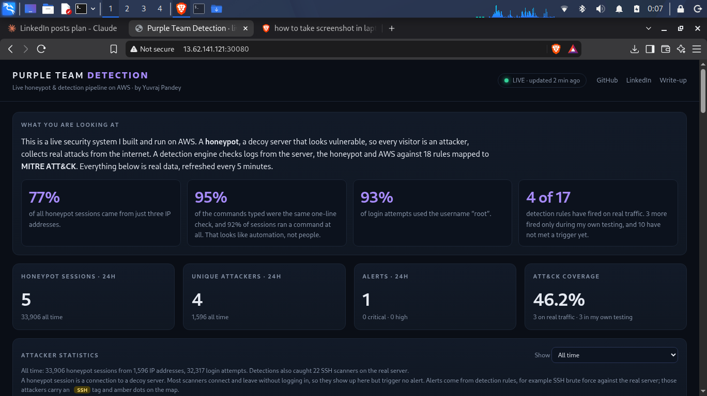
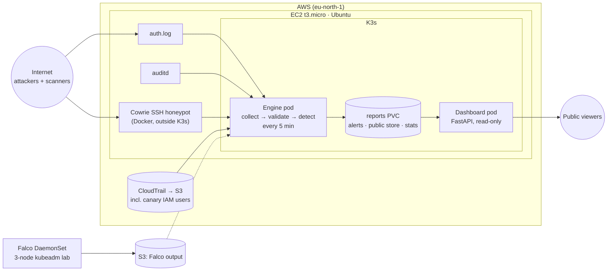
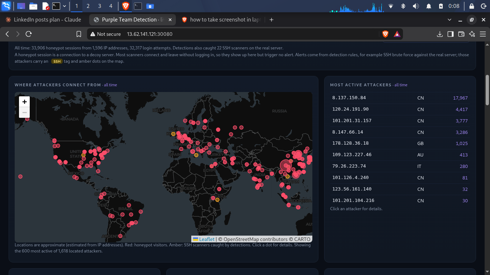
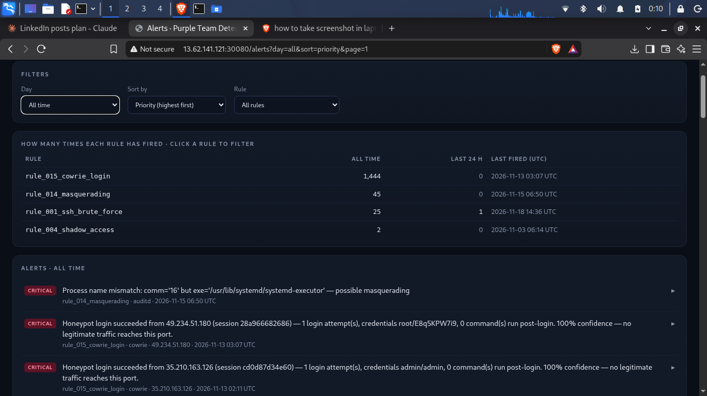
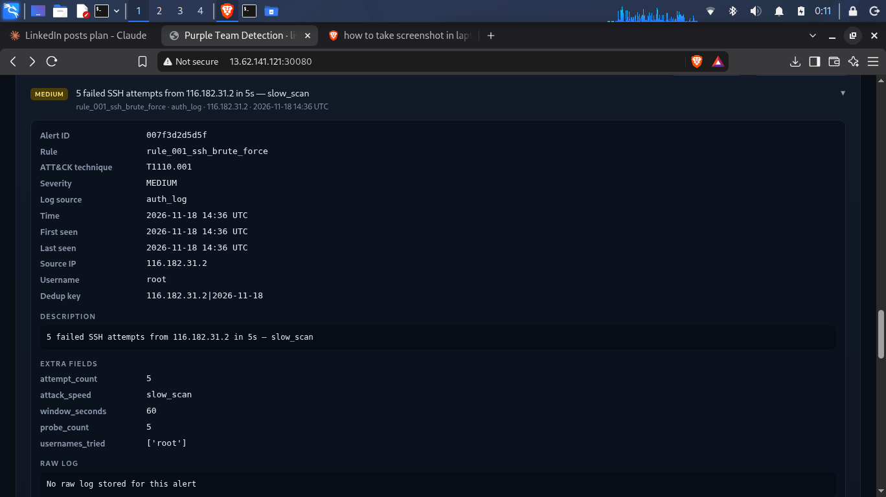
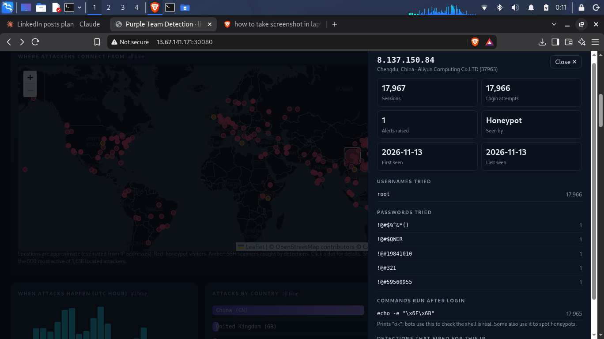

# Purple Team Detection Pipeline

**A detection engine I built from scratch, running 24/7 on an internet-facing AWS server, catching real attackers.**

An SSH honeypot, canary AWS credentials and host logs feed a schema-first Python detection engine. The engine runs on Kubernetes (K3s) on a single 1 GB EC2 instance and publishes everything it sees to a live, public, read-only dashboard.

[](https://github.com/Yuvraj-pandey-yuvi/purple-team-detection/actions/workflows/ci.yml)

**Live dashboard:** [http://13.62.141.121:30080](http://13.62.141.121:30080) (HTTPS coming soon)



## At a glance

| | |
|---|---|
| **Real attacker traffic** | 33,906 honeypot sessions from 1,596 attacker IPs |
| **Detection rules** | 18 custom Python rules covering 13 ATT&CK techniques across 7 tactics (ATT&CK v17), plus a log-silence monitor |
| **Log sources** | 5: `auth.log`, `auditd`, AWS CloudTrail, Cowrie honeypot, Falco |
| **Tests** | 268 pytest tests, run by GitHub Actions on every push |
| **Detection-as-code** | 13 Sigma rules (portable to Splunk / Elastic / Sentinel), 6 analyst playbooks |
| **Infrastructure** | AWS EC2 t3.micro (1 GB RAM), K3s, Docker, Terraform, GHCR |

## What makes this different

- **It sees real attacks, not only simulated ones.** The server is deliberately exposed. Real bots started scanning it within 24 hours, and every number on the dashboard comes from genuine attacker traffic.
- **Schema-first.** Every raw log line becomes a validated, typed Pydantic object before any rule sees it. Rules never parse strings or guard against missing keys.
- **Three kinds of high-confidence trap.** A Cowrie SSH honeypot (any login is malicious), **canary AWS credentials** planted on the real host (any use means the host is compromised), and pattern-based rules for everything else.
- **It watches its own inputs.** For weeks, "0 alerts" and "0 input" looked identical. `rule_018` now raises an alert when any log source goes quiet for longer than its limit.
- **It runs on a 1 GB box.** That is a real constraint. Falco had to move to a 3-node test cluster after OOM kills that I traced to kernel-accounted eBPF memory (details below).
- **The public dashboard is safe to share.** The engine writes a separate public alert store in which AWS account IDs, internal hostnames, private IPs and the server's own IPs are masked, and CloudTrail raw logs are withheld. Tests check for leaks.

## What the honeypot shows

These figures come straight from the live dashboard:

- **77%** of all honeypot sessions came from just **three IP addresses**.
- **93%** of login attempts used the username `root`.
- **92%** of sessions ran a command, and **95%** of the commands typed were the same one-line check. That's automation, not people.

## Architecture



**Pipeline:** log sources → incremental collectors (byte offsets plus inode tracking, so log rotation never causes missed or re-read lines) → Pydantic schema layer → 18 detection rules → deduplicated alert store → public masked store and summary → dashboard.

**Why Cowrie runs outside K3s:** it's the one component built to be attacked. Running it as a standalone container keeps it isolated from the cluster, and K3s would add nothing for that workload.

## Detection rules

| # | Technique | Name | Source | How it detects |
|---|---|---|---|---|
| 001 | T1110.001 | SSH brute force and probing | auth.log | Sliding window (60s), with "Invalid user" probes counted per source IP |
| 002 | T1078 | Console login without MFA | CloudTrail | `sessionContext.mfaAuthenticated` on ConsoleLogin and API calls |
| 003 | T1136.001 | Local account created | auth.log | `useradd` pattern, suspicious-username set |
| 004 | T1003.008 | `/etc/shadow` access | auditd | `shadow_access` key + exe whitelist + admin guard |
| 005 | T1548 | Privilege escalation | auditd | `euid=0` with a real non-root `auid` |
| 006 | T1078.001 | Root account login | CloudTrail | `userIdentity.type == "Root"` + successful ConsoleLogin |
| 007 | T1110.001 | Brute force success | auth.log | ≥5 failures from an IP followed by an accepted login within 600s |
| 008 | T1053.003 | Cron persistence | auditd | `cron_modification` key + path-modifying syscalls only |
| 009 | T1562.008 | CloudTrail disabled | CloudTrail | `DeleteTrail`/`StopLogging` (CRITICAL), `UpdateTrail`/`PutEventSelectors` (HIGH) |
| 010 | T1562.012 | auditd / logging tamper | auditd | 4 tamper keys; severity scales with privilege |
| 011 | T1548 | Sudoers tamper | auditd | Any write to `/etc/sudoers` or `/etc/sudoers.d/` |
| 012 | T1087.001 | Account enumeration | auditd | 5+ enumeration commands in 120s per user |
| 013 | T1082 | System discovery | auditd | 5+ recon commands (`uname`, `ss`, …) in 120s per user |
| 014 | T1036 | Masquerading | auditd | exe/comm mismatch, sensitive name in an untrusted path |
| 015 | T1110.001 | Honeypot login | Cowrie | Any successful honeypot login; one alert per attacker IP per day, flags download tools and `chmod +x` |
| 016 | T1078 | Canary credential used | CloudTrail | Any API call by one of 3 zero-permission canary IAM users planted on the host |
| 017 | Falco tags | Falco passthrough | Falco | Brings Falco's MITRE-tagged runtime alerts into the same alert store |
| 018 | T1562.001 / .008 | Log source went silent | all | A source quiet past its limit (1h host logs, 24h honeypot/CloudTrail) opens one alert; recovery closes it |

**Coverage today:** 6 of the 13 techniques (46.2%) have produced a detection: 3 on real attacker traffic and 3 during my own purple-team tests. So far 4 of the 17 attack rules have fired on real traffic. The rest either haven't met a real trigger yet or still need a safe simulation, and the dashboard shows which state each technique is in.

## Infrastructure

- **Compute:** a single EC2 t3.micro (2 vCPU, 1 GB RAM), provisioned with **Terraform** (remote state in S3 with DynamoDB locking). Canary IAM users are defined in `terraform/canary.tf`.
- **Orchestration:** **K3s** runs the engine and dashboard as Deployments sharing a PersistentVolumeClaim. The engine mounts host log directories read-only, and the dashboard mounts the PVC read-only.
- **Images:** built from this repo and pushed to **GHCR**, deployed with commit-SHA tags.
- **Least-privilege IAM:** the instance role can only list and read the CloudTrail prefix. CloudTrail ingestion once returned 0 events for weeks: the instance role had no S3 permission, and the collector was discarding the `aws s3 sync` errors. I fixed it with a dedicated narrow role, not by widening the existing one.
- **Falco (runtime security):** validated as a DaemonSet (modern eBPF driver, custom ATT&CK-mapped rules) on a 3-node kubeadm + Calico lab cluster, shipping alerts to S3 for the engine. On the t3.micro it was OOM-killed repeatedly. `dmesg` showed a cgroup OOM where Falco's own RSS was tiny (~35 MB), but eBPF ring buffer and map memory is charged to the container by the kernel. That's a real capacity ceiling, not a tuning problem. The failed config is kept in `docs/` for reference.
- **Access:** SSH with keys only (password login off), or AWS SSM Session Manager.

## Public dashboard

A read-only FastAPI app (every write endpoint removed). It shows:

- headline cards (24h and all-time), a 30-day timeline and an ATT&CK coverage matrix
- an attacker map (Leaflet, server-side geolocation) and the top attacker IPs, with drill-down per IP
- the usernames and passwords attackers tried, and the commands they typed in the honeypot
- an alerts page: browse any day, sort by priority or time, filter by rule, click a row for every stored field
- a pipeline-health panel showing when each log source last delivered input

| Attacker map | Alerts browser |
|---|---|
|  |  |

| Alert detail | Attacker drill-down |
|---|---|
|  |  |

## Schema layer

```
/var/log/auth.log     →  AuthLogEvent     (source_ip, auth_result, username, port)
/var/log/audit.log    →  AuditdEvent      (auid, uid, euid, exe, comm, key, name)
S3 CloudTrail JSON    →  CloudTrailEvent  (actor_username, mfa_authenticated, event_name)
Cowrie JSON           →  CowrieSession    (src_ip, logins, commands, duration)
S3 Falco JSONL        →  FalcoEvent       (rule, priority, tags, output_fields)
```

- **`frozen=True`:** events are immutable, so one rule cannot corrupt the data another rule reads.
- **UTC everywhere:** a two-layer validator chain turns every source format (including syslog's yearless timestamps) into a UTC-aware `datetime`.
- **auditd multi-record grouping:** `SYSCALL` and `PATH` records are joined by serial number before parsing, so filenames aren't lost.
- **Optional Falco fields:** different Falco rules emit completely different field sets (confirmed against Falco's own issue tracker), so the schema doesn't pretend otherwise.

## Correlation engine (built, being wired in)

`correlation/` links related alerts into incidents. For example, a cron persistence alert gets linked to the brute-force success that came before it on the same account, within a 2-hour window. That window is based on published attacker breakout-time research. Matching is deterministic and uses author-defined chains, not inferred ones. Incidents keep their open/closed state across re-runs and are archived after closing. It has 12 dedicated tests and runs manually today. Scheduling and a display view are next.

## Testing and CI

**268 tests**: happy paths, guard conditions and exact window-boundary cases for every rule, plus the schema layer, collectors, public masking, the dashboard API and the correlation lifecycle. GitHub Actions runs them on a clean runner on every push and pull request.

Real bugs that testing found:

- **`rule_011` (sudoers tamper) could never fire.** There was no auditd watch on `/etc/sudoers`, and the rule matched file *content* that auditd never records (it logs syscall metadata only). Unit tests on mocked events would never have caught either problem. Only checking against the live system did.
- A refactor silently deleted `rule_004`'s admin-exclusion guard. A regression test caught it before any false CRITICALs.
- `requirements.txt` was missing two packages that only worked locally because they were already installed. A clean CI runner exposed it.
- A `sys.path` bug made tests pass under `python -m pytest` but fail under plain `pytest` in CI.

## Known limitations

Documenting gaps precisely is part of detection engineering:

- Only some rules have fired on live traffic. CloudTrail rules (002/006/009/016) need a safe purple-team simulation to prove them.
- Correlation uses nearest-preceding-by-time matching. Two breaches of the same account within the window could be attributed wrongly. The real fix is auditd session (`ses=`) tracing.
- Sudo token hijacking (T1548.003), full EXECVE argument parsing, living-off-the-land with whitelisted binaries and VPC Flow Log analysis are not implemented.
- Per-IP-per-day alerts (rules 001 and 015) report "at least N" attempts. Exact volumes live in the dashboard statistics.
- CloudTrail fixtures come from a real captured record. They don't follow schema changes automatically.

## How to run

```bash
git clone https://github.com/Yuvraj-pandey-yuvi/purple-team-detection
cd purple-team-detection
pip install -r requirements-dev.txt

python -m pytest -q tests/                                  # run the test suite
python3 detection/engine.py                                 # one detection cycle (needs the log sources)
python3 -m uvicorn dashboard.api:app --host 0.0.0.0 --port 8000
```

To deploy on K3s, build the image from the `Dockerfile`, push it to a registry and apply `k8/core-manifests.yaml`. Infrastructure is in `terraform/`.

## What I learned

- **False positives are the real work.** `unix_chkpwd` reads `/etc/shadow` on every SSH login. Going from 68 noisy alerts to 5 real ones meant learning what normal looks like from actual logs.
- **A rule can be correct and still be dead.** If the data source behind it was never wired up, passing tests prove nothing. Check rules against live data.
- **Silence is a signal.** A collector stuck on a frozen file looks exactly like a quiet server. Monitor the inputs, not only the outputs.
- **Capacity limits are findings, not failures.** Diagnosing Falco's OOM down to kernel-accounted eBPF memory taught me more than a successful install would have.
- **Documentation drifts by default.** This README had drifted twice. The tables above are checked against the rule source files.

## Author

**Yuvraj Pandey**, B.Tech Computer Science, JNU (2024–2028)
